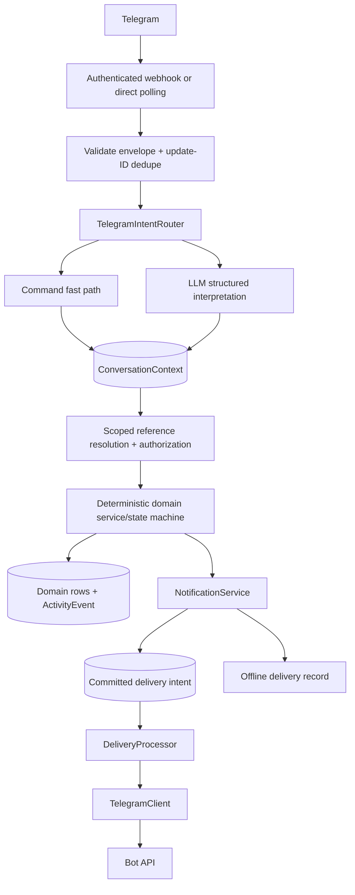
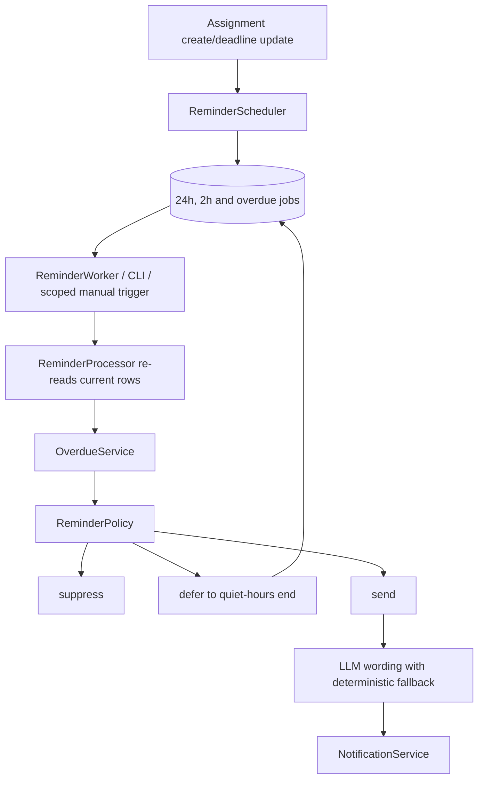

# Architecture

## Boundaries

- `app/web` owns HTTP, sessions, and forms. `classrooms.py` handles rosters, invites, and Telegram linking. `student_support.py` handles staff replies and their protected attachments. `live.py` reports an authorization-scoped version to open work and review pages.
- `app/telegram/service.py` validates and deduplicates update envelopes; `router.py` dispatches to `teacher.py` or `student.py`; `conversation.py` persists short-lived context; `files.py` confines downloads; `client.py` is the Bot API boundary.
- `app/services` owns authorization, classes/invites, assignment mutations, reference resolution, progress, submissions/feedback, notifications, overdue transitions, risk scoring, and the state machine.
- `app/reminders/scheduler.py` creates durable versioned jobs, `processor.py` re-reads state and executes them, `policy.py` chooses deterministic actions, and `worker.py` polls safely. `app/services/delivery.py` dispatches committed Bot API requests and records results.
- `app/llm` defines Pydantic schemas, a provider interface, a current OpenAI Responses implementation, a deterministic test/demo implementation, and interaction logging/error containment.
- `app/models.py` and `app/database.py` own the relational model, foreign keys, constraints, WAL, and transaction primitives.

Transport handlers never authorize from user-supplied IDs. They first resolve an authenticated actor, restrict candidate queries to that actor’s server-side memberships, then call a domain service. SQLAlchemy sessions are caller-owned so related rows commit or roll back together.

## Telegram flow

Unlinked senders receive connection guidance. The bot ignores group chat updates. Callback buttons are translated into the same command path; they do not mutate state directly. Ambiguous references produce choices. A 30-minute context holds the last explicitly selected assignment or a pending teacher/student action. A file-first update stores its Telegram metadata until the student chooses an eligible assignment. Every choice is re-authorized.

An authorized teacher or coordinator issues a private connection token for an existing class student. `TelegramLinkService` stores its SHA-256 digest. `/start TOKEN` validates membership and link conflicts, saves numeric Telegram identifiers, and consumes the token in one transaction. Regeneration revokes earlier unused tokens. Teachers and coordinators can generate their own links from authorized workspaces. A linked student can use `/join CODE` within their existing school.

## Reminder flow

The database, not memory, is the durable queue. A deadline edit increments `Assignment.schedule_version`, cancels pending/deferred jobs from prior versions, and adds new pre-deadline and overdue jobs with versioned unique keys. Processing cancels stale versions, transitions eligible states to overdue before policy evaluation, never sends during school-local quiet hours, suppresses cancelled/submitted/completed work, and frequency-limits blocker follow-ups.

The background worker passes no scope and is the system-wide actor. Web callers calculate authorized class IDs from memberships and pass that set into the same processor. A user-supplied class ID is never used as reminder authority.

## Notification lifecycle

`NotificationService` is the only assignment-related message boundary. Creation, deadline changes, instruction clarification, cancellation, feedback, and reminders all persist `NotificationDelivery` with `school_id`, `classroom_id`, `assignment_id`, recipient, status, body, idempotency key, attempts, and errors. An unlinked student is `skipped`; log mode is `logged`; real Bot API success is `sent`; failures are `failed` and receive bounded 1/5/15-minute retries.

Teacher delivery queries use assigned class IDs. Manual coordinator reminder runs use classes in the selected school. External failure does not invalidate a correct domain mutation. The business transaction commits pending delivery intents and inline buttons. A short SQLite reservation claims one delivery, then the worker releases the lock before calling Telegram and records the result in a new transaction. A process restart retries expired claims. A crash after Telegram accepts a message and before the result commits can still produce a duplicate.

## File flow

Telegram document/photo -> resolve authorized assignment or hold metadata for a reply -> `getFile` -> authenticated Bot API download -> streamed size check -> UUID filename under resolved `UPLOAD_DIR` -> SHA-256 hash -> idempotent `Submission`. The original filename is metadata only. Browser uploads use the same path-confinement and byte limit principles.

Workspace-scoped submission and support-reply download routes check current authorization and verify the resolved file path stays below `UPLOAD_DIR`. Missing or out-of-root files return 404. Supported images can render inline, and other files are attachments.

## Transactions and idempotency

- Assignment creation: assignment, targets, independent states, versioned jobs per student, activity, operation key, and contextual delivery rows.
- Deadline update: aware future-time validation, version increment, prior-job cancellation, replacements, activity, operation key, and student deliveries.
- Submission: authorized assignment, unique transport/form key, content hash, state transition, and activity.
- Feedback: unique form key, feedback, review transition, activity, and delivery.
- Telegram: atomically reserve a unique update ID before dispatch and commit it with the operation. Duplicate deliveries exit before any state change.
- Telegram linking: unique token digest, row lock where supported, expiry/revocation/use checks, Telegram uniqueness, explicit disconnect before account replacement, and one transaction for link plus consumption.

Database uniqueness protects update IDs, operation keys, targets/states, submissions, feedback keys, reminder keys, delivery keys, memberships, and conversation `(user_id, chat_id)`.

## LLM safety boundary

The model may classify intent, extract human references and relative deadlines, parse progress, summarize already-authorized risk items, and phrase a policy-approved reminder. It may not select database IDs, authorize, execute SQL, create memberships, mutate state, bypass transitions, or send messages. Pydantic schemas, aware-time validation, a confidence threshold, scoped reference resolution, and domain services contain bad output. Every model operation records success or an error type without API keys.

## Deployment shape

The app runs in one FastAPI process with SQLite/WAL, background delivery and reminder tasks, and local files. Direct Telegram polling supports local use. Hosted HTTPS deployments can use webhooks. A distributed deployment would require coordinated migrations, shared object storage, and workers with durable leases.
