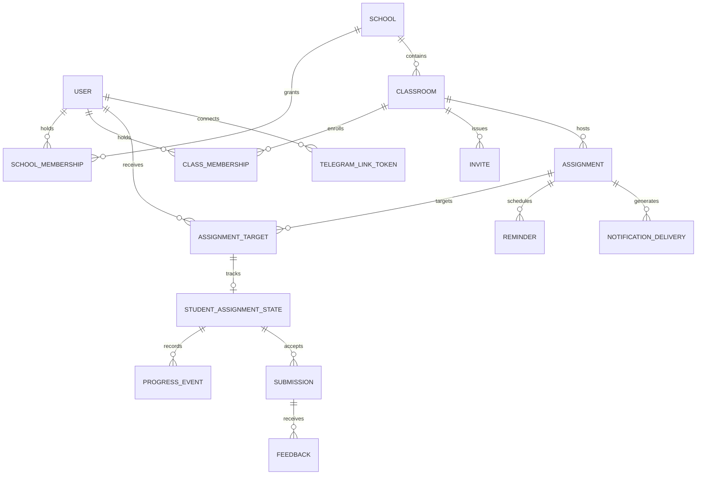
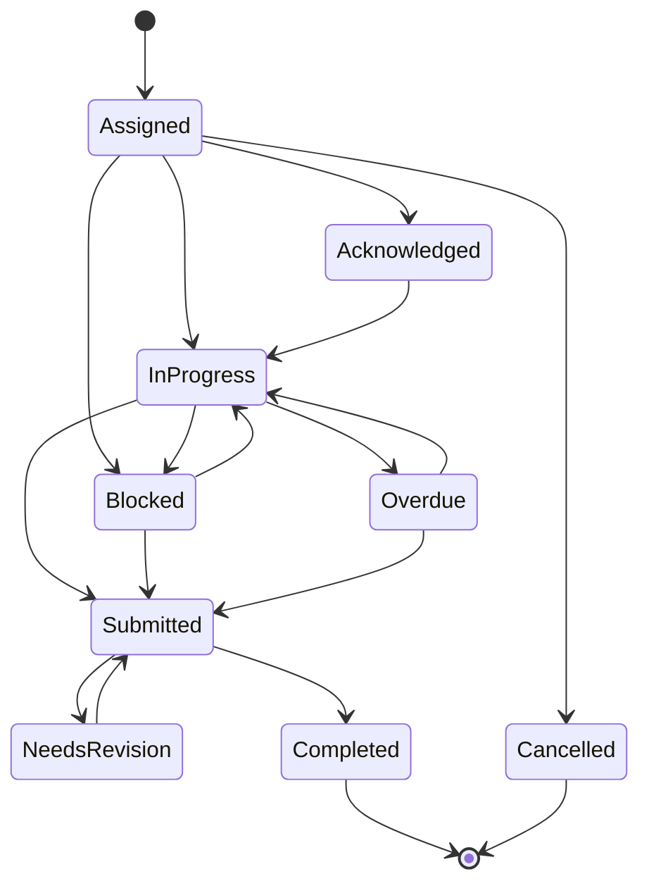

# Class Relay

Class Relay by Super Intelli Machines is a Telegram-first assignment workflow with teacher, coordinator, and student web views. Teachers can create, publish, clarify, reschedule, or cancel work, monitor risk, and review submissions. Students can join an authorized class, track deadlines, ask for help, submit text or files, and receive feedback. FastAPI and Jinja serve the UI, SQLAlchemy persists data to SQLite, and an in-process worker handles reminder jobs and delivery retries.

This checkout extends the existing `classroom-companion` repository at `d7665d7`. It retains the existing implementation and history. [DEMO.md](DEMO.md) contains an executable local acceptance walkthrough and the real Telegram setup flow.

## Quick start

From the repository root on Windows with Python 3.12 or newer installed:

```powershell
python -m venv .venv
.\.venv\Scripts\python.exe -m pip install -e ".[dev]"
Copy-Item .env.example .env
.\.venv\Scripts\python.exe -m scripts.seed
.\.venv\Scripts\python.exe -m uvicorn app.main:app --reload --no-access-log
```

On macOS or Linux use `.venv/bin/python` and `cp .env.example .env`. Run commands from the repository root so the scripts, templates, static assets, and `.env` resolve correctly. Open `http://127.0.0.1:8000` or check `GET /health`. The seed script initializes a fresh database and can be run again without duplicating the demo school. Startup also creates missing tables and applies additive upgrades. Use a fresh database to get the credentials below if you have demo data from an earlier revision.

| Account | Email | Password |
|---|---|---|
| Teacher | `teacher@demo.local` | `Teacher123!` |
| Linked student in log mode | `student1@demo.local` | `Student123!` |
| Unlinked student | `student2@demo.local` | `Student123!` |
| Coordinator | `coordinator@demo.local` | `Coordinator123!` |
| Teacher from another school | `teacher@northstar.demo.local` | `Teacher123!` |

Grade 8 - A uses invite `CLASS8A`. Log mode seeds test Telegram IDs for the teacher and Student 1. For a live bot, configure real mode before seeding a fresh database and connect the two real accounts using their private links.

## Configuration

| Variable | Default and purpose |
|---|---|
| `DATABASE_URL` | `sqlite:///./classroom_companion.db` |
| `SESSION_SECRET` | Set a long random value for a shared deployment. Signs sessions and CSRF tokens. |
| `ENVIRONMENT` | `development`. Use `production` behind HTTPS for secure cookies, required random session signing, and disabled demo seeding. |
| `SCHOOL_TIMEZONE` | `Asia/Kolkata`, the default IANA timezone for school provisioning. |
| `LLM_MODE` | `fake` for an offline demo. Set `real` to enable language understanding with OpenAI. |
| `OPENAI_API_KEY` | Required in real LLM mode. |
| `OPENAI_MODEL` | `gpt-5-mini`. Set a model available to your account that supports Structured Outputs. |
| `LLM_CONFIDENCE_THRESHOLD` | `0.75`. Low-confidence intent needs clarification. |
| `TELEGRAM_MODE` | `log` for local delivery records or `real` for the Bot API. |
| `TELEGRAM_BOT_TOKEN`, `TELEGRAM_BOT_USERNAME` | BotFather token and bot username. The username enables connection links. |
| `TELEGRAM_WEBHOOK_SECRET` | Set a long random value in real mode. The webhook verifies both the path and Telegram's matching header. |
| `BASE_URL` | `http://127.0.0.1:8000`. Set your public HTTPS origin for webhook registration. |
| `TELEGRAM_LINK_TOKEN_MINUTES` | `30` minutes. |
| `UPLOAD_DIR`, `MAX_UPLOAD_BYTES` | `uploads` and `10485760` bytes (10 MiB). |
| `QUIET_HOUR_START`, `QUIET_HOUR_END` | School-local `22` and `7`. Equal values disable quiet hours. |
| `REMINDER_INTERVAL_SECONDS` | `45` seconds. `0` pauses reminder evaluation for demos. Committed live Telegram sends are still dispatched. |
| `CONVERSATION_CONTEXT_MINUTES` | `30` minutes. |
| `NOTIFICATION_MAX_ATTEMPTS` | `3` total attempts per delivery. |

### Live Telegram and OpenAI

1. Create a bot with [BotFather](https://t.me/BotFather) and configure its token and username in `.env`. Set `TELEGRAM_MODE=real`, `LLM_MODE=real`, and `OPENAI_API_KEY`.
2. Generate separate secrets for `SESSION_SECRET` and `TELEGRAM_WEBHOOK_SECRET` using `python -c "import secrets; print(secrets.token_urlsafe(48))"`. Start a public HTTPS tunnel forwarding to local port 8000 and set `BASE_URL` to the tunnel origin. Keep Uvicorn access logging disabled because the webhook path contains the secret. Configure any proxy to redact that path too.
3. Start the server, then run `python -m scripts.set_telegram_webhook` and `python -m scripts.check_telegram_webhook` from the configured virtual environment. See [TELEGRAM_SETUP.md](TELEGRAM_SETUP.md) for setup and troubleshooting.
4. Open Grade 8 - A as the teacher, select **Connect my Telegram**, and press **Start** with your Telegram account. Generate Student 1's link and privately open it with a second Telegram account. Leave Student 2 unlinked for the scenario.

Bot commands include `/start`, `/help`, `/classes`, `/assign`, `/status`, `/reminders`, `/join CODE`, `/ack`, `/progress`, `/blocked`, and `/submit`. `/cancel` clears a pending chat request. `/join CODE EMAIL` also works when the email matches the account already connected. Use `/progress ID 50` for an explicit percentage or a natural message for interpretation. `/assign CLASS_ID` accepts task text with a deadline. The bot accepts private chats and uses the authenticated link as the sender identity. If it needs a choice, reply with the displayed `#ID` or full name. A photo can follow “Here’s my homework.” If the photo arrives first, the bot holds it for up to 30 minutes while you choose an assignment.

## Architecture


### Relational model



The state/progress relationship uses the assignment and student pair. SQLite foreign keys, membership and target uniqueness, and deterministic service checks constrain writes. `ActivityEvent`, `LLMInteraction`, `ProcessedTelegramUpdate`, and `IdempotencyKey` preserve audit and retry context.

### Lifecycle and access

The shared assignment moves from draft to assigned to cancelled. Publishing starts one independent state per target and schedules deliveries. Students cannot read drafts. Submitted work can move to revision or completion through teacher feedback. An extension restores the previous work state if the worker marked it overdue. A late submission remains possible.



Coordinators inherit access to classes in their school. Teachers need class membership. Students see only their own targeted work and associated progress, files, reminders, and feedback. An invite permits an already-linked student to join within their school. It cannot link an arbitrary pre-created account. Initial linking uses the one-time private token issued in the authenticated UI. See [REASONING.md](REASONING.md) for state, authorization, and identity trade-offs.

### Time, reminders, and LLM boundary

Store instants in UTC and display deadlines in school time. Morning is 09:00, afternoon 15:00, and evening or a bare day 18:00. A bare weekday means its next future occurrence. `Next Friday` refers to the following calendar week. Ask for AM/PM when the intended time is ambiguous. Domain services reject past or timezone-naive deadlines.

Schedule jobs at 24 hours, 2 hours, and shortly after the due time. A near-term assignment skips the overlapping 24-hour job. At send time, final or submitted work is suppressed. Quiet hours defer a job, blockers receive support at most once per 12 hours, and a student without acknowledgement or activity receives a distinct reminder. Recent progress can suppress the 24-hour reminder. Work awaiting revision gets a revision-specific reminder. Only one overdue notice is attempted per target and deadline version. Deadline changes invalidate old pending jobs and notify the targeted students. The worker, authorized **Run reminders** action, and `python -m scripts.run_reminders` share the policy.

The OpenAI Responses adapter parses intents and summaries into Pydantic schemas and generates reminder wording. Authorization, class and student matching, state transitions, timing, and routing stay in deterministic code. An uncertain or invalid result asks for clarification. Failed wording uses a deterministic template. Log mode records hypothetical Telegram deliveries, while fake LLM mode is the offline test and review option. [OpenAI Structured Outputs](https://developers.openai.com/api/docs/guides/structured-outputs?api-mode=responses)

### Idempotency and observability

SQLite reserves the writer before mutations that decide side effects. Telegram claims the update ID with a unique insert in the same transaction as domain changes. Forms, feedback, submissions, and reminder jobs use unique operation or dedupe keys. Domain transactions persist activity and delivery records. The worker checks committed intents, revalidates recipient and reminder scope, and makes Bot API calls after releasing the write lock. Logs carry request/update IDs, delivery outcomes, authorization denials, and sanitized failure types. Interaction audit records can contain classroom content and need appropriate retention and access controls in a pilot.

## Verification and operations

```powershell
python -m ruff check app scripts tests
python -m pytest -q
python -m scripts.run_reminders
```

Use the virtual environment's Python for these commands. Tests mock both providers. Transport contract tests exercise the installed OpenAI SDK’s Responses parser and Telegram download and send paths without credentials. GitHub Actions runs Ruff and pytest on Python 3.12 for pushes and pull requests. For the executable offline walkthrough and restart check, follow [DEMO.md](DEMO.md).

## Pilot limits and production path

Run a single FastAPI process. The SQLite writer reservation can span an interpretation call or inbound file download. Slow providers can cause a retryable HTTP 503 under write contention. Outbound delivery starts after the business transaction commits. Telegram has no send idempotency key. A crash or ambiguous timeout after Telegram accepts a message can cause a duplicate delivery despite local dedupe. For more volume, move the SQLite delivery ledger and domain data to PostgreSQL with Alembic, dispatch through a durable queue with distributed workers, and add observability and dead-letter tools. Use object storage with file scanning and retention, managed sign-in, rate limiting, and a secret manager for a wider deployment. Old demo databases may contain deadlines recorded as wall-clock values by an earlier version. Recheck those deadlines before using existing data in a live pilot.
