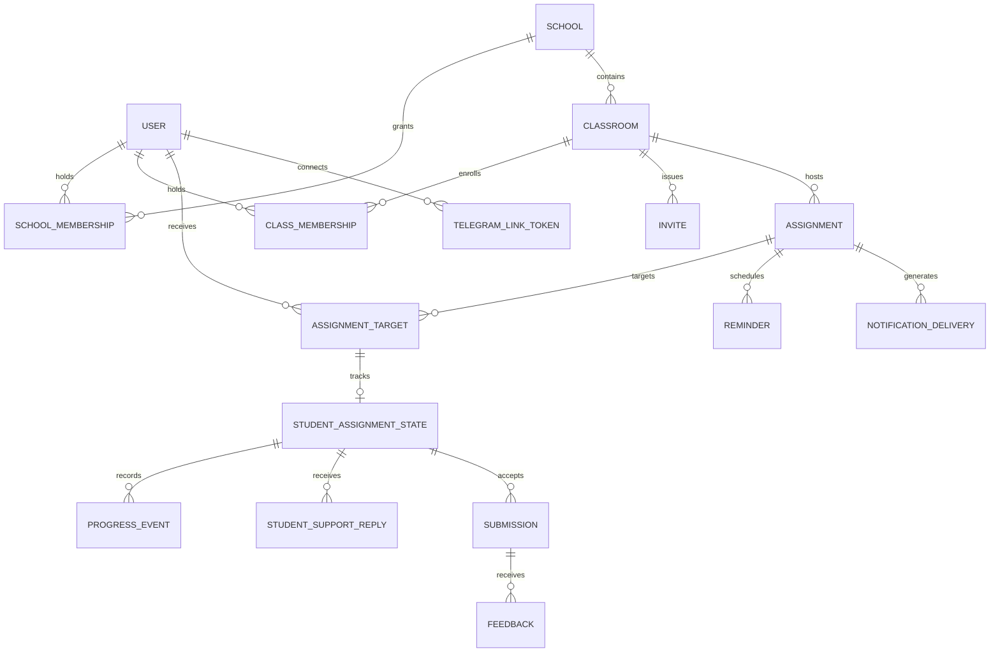
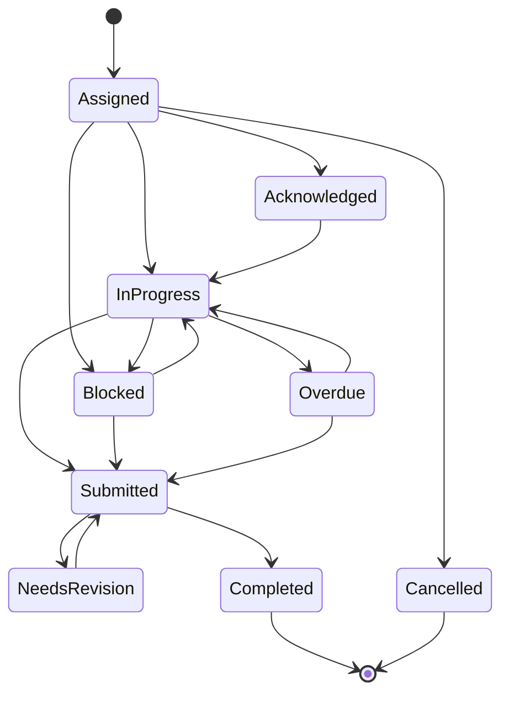

# Class Relay

Class Relay by Super Intelli Machines connects classroom assignments, progress, and feedback across web and Telegram. Coordinators manage schools, staffing, enrollments, and school-wide reviews. Teachers publish and revise assignments, track progress, and review student work. Students see their own assignments, turn in text or files, ask for help, and read feedback.

The web app has a searchable demo account picker and a light/dark toggle that defaults to light. Open work and review pages check for changes every three seconds and preserve unsaved edits. Telegram uses the same records and offers a menu tailored to the linked account’s roles.

## Quick start

For the full reviewer dataset with three schools and an isolated database, follow the [full demo setup](DEMO.md#full-reviewer-dataset).

From the repository root on Windows with Python 3.12 or newer installed:

```powershell
python -m venv .venv
.\.venv\Scripts\python.exe -m pip install -e ".[dev]"
if (!(Test-Path .env)) { Copy-Item .env.example .env }
.\.venv\Scripts\python.exe -m scripts.seed
$env:DEMO_MODE = 'true'
.\.venv\Scripts\python.exe -m uvicorn app.main:app --host 127.0.0.1 --port 8767 --no-access-log
```

On macOS or Linux use `.venv/bin/python`, `cp -n .env.example .env`, and `export DEMO_MODE=true`. Run commands from the repository root. Open [Class Relay](http://127.0.0.1:8767/login) and choose **Show demo accounts**. The seed can be run again without duplicating the demo school. Startup creates missing tables and applies additive upgrades.

| Account | Email | Password |
|---|---|---|
| Teacher | `teacher@demo.local` | `Teacher123!` |
| Linked student in log mode | `student1@demo.local` | `Student123!` |
| Unlinked student | `student2@demo.local` | `Student123!` |
| Coordinator | `coordinator@demo.local` | `Coordinator123!` |
| Teaching coordinator | `lead@demo.local` | `Coordinator123!` |
| Teacher from another school | `teacher@northstar.demo.local` | `Teacher123!` |

Grade 8 - A uses invite `CLASS8A`. A fresh seed assigns the teacher and Student 1 to Grades 8 - A and 8 - B, and gives the teaching coordinator Grade 8 - C. Log mode seeds test Telegram IDs for the teacher and Student 1. For a live bot, configure real mode before seeding a fresh database and connect the two real accounts using their private links.

## Configuration

| Variable | Default and purpose |
|---|---|
| `DATABASE_URL` | `sqlite:///./classroom_companion.db` |
| `SESSION_SECRET` | Set a long random value for a shared deployment. Signs sessions and CSRF tokens. |
| `ENVIRONMENT` | `development`. Use `production` behind HTTPS for secure cookies, required random session signing, and disabled demo seeding. |
| `DEMO_MODE` | `false`. Set to `true` to show the login account picker on a seeded development server using the fake LLM. In real Telegram mode the picker is available on loopback only. |
| `SCHOOL_TIMEZONE` | `Asia/Kolkata`, the default IANA timezone for school provisioning. |
| `LLM_MODE` | `fake` for an offline demo. Set `real` to enable language understanding with OpenAI. |
| `OPENAI_API_KEY` | Required in real LLM mode. |
| `OPENAI_MODEL` | `gpt-5-mini`. Set a model available to your account that supports Structured Outputs. |
| `SPEECH_MODE` | `off` by default. Set `openai` with `OPENAI_API_KEY` to enable dictation in the teacher assignment form. |
| `OPENAI_TRANSCRIPTION_MODEL` | `gpt-transcribe` by default. |
| `LLM_CONFIDENCE_THRESHOLD` | `0.75`. Low-confidence intent needs clarification. |
| `TELEGRAM_MODE` | `log` for local delivery records or `real` for the Bot API. |
| `TELEGRAM_BOT_TOKEN`, `TELEGRAM_BOT_USERNAME` | BotFather token and bot username. The username enables connection links. |
| `TELEGRAM_WEBHOOK_SECRET` | Set a long random value in real mode. The webhook verifies both the path and Telegram's matching header. |
| `TELEGRAM_UPDATES` | `webhook` by default. Use `polling` for a local live bot without a public URL. Clear any existing webhook in Telegram with `drop_pending_updates=false` before polling and run one application process. |
| `BASE_URL` | `http://127.0.0.1:8767`. Set a public HTTPS origin only for webhook registration. |
| `TELEGRAM_LINK_TOKEN_MINUTES` | `30` minutes. |
| `UPLOAD_DIR`, `MAX_UPLOAD_BYTES` | `uploads` and `10485760` bytes (10 MiB). |
| `QUIET_HOUR_START`, `QUIET_HOUR_END` | School-local `22` and `7`. Equal values disable quiet hours. |
| `REMINDER_INTERVAL_SECONDS` | `45` seconds. `0` pauses reminder evaluation for demos. Committed live Telegram sends are still dispatched. |
| `CONVERSATION_CONTEXT_MINUTES` | `30` minutes. |
| `NOTIFICATION_MAX_ATTEMPTS` | `3` total attempts per delivery. |

### Live Telegram and OpenAI

For local use, Class Relay can receive updates directly from Telegram with `TELEGRAM_MODE=real` and `TELEGRAM_UPDATES=polling`. A hosted deployment can use an HTTPS webhook. OpenAI is optional for Telegram and can be enabled separately for assignment interpretation or dictation. Follow the [Telegram setup guide](TELEGRAM_SETUP.md).

Use **Connect my Telegram** from an authorized teacher or coordinator workspace. Staff can issue a private connection link for an enrolled student. Once linked, send `/start` or `/menu` to see the available actions. A student can open **My assignments** to mark work as read, report progress, ask for help, or turn in work. `/cancel` clears a pending chat action.

## Architecture

```mermaid
flowchart LR
    Browser --> FastAPI --> Session[Signed session + CSRF]
    Telegram --> Updates[Authenticated webhook or direct polling]
    Updates --> Intent[Update deduplication and intent handling]
    Session --> Scope[School, class and owner authorization]
    Intent --> Scope
    Scope --> Domain[Assignments, progress, review and feedback]
    Domain --> SQLite[(SQLite and activity history)]
    SQLite --> Worker[Worker, CLI or scoped web trigger]
    Worker --> Policy[Deterministic reminder policy]
    Policy --> Wording[OpenAI wording or template]
    Wording --> Outbox[(Committed Telegram delivery intent)]
    Domain --> Outbox
    Outbox --> Delivery[Telegram delivery and bounded retry]
```



### Relational model



The state/progress relationship uses the assignment and student pair. SQLite foreign keys, membership and target uniqueness, and deterministic service checks constrain writes. `ActivityEvent`, `LLMInteraction`, `ProcessedTelegramUpdate`, and `IdempotencyKey` preserve audit and retry context.

### Lifecycle and access

The shared assignment moves from draft to assigned to cancelled. Publishing starts one independent state per target and schedules deliveries. Students cannot read drafts. Submitted work can move to revision or completion through teacher feedback. An extension restores the previous work state if the worker marked it overdue. A late submission remains possible.



Coordinators manage classes, staffing, and classwork within their own school. **Remove from school** ends student access across that school’s classes, while preserving staff access to past work and the student’s memberships elsewhere. The Teacher workspace and Telegram teaching commands require a teacher membership in the class. Students see their own targeted work and associated progress, files, reminders, support replies, and feedback. An invite permits an already-linked student to join within their school. See [REASONING.md](REASONING.md) for state, authorization, and identity decisions.

### Time, reminders, and LLM boundary

Store instants in UTC and display deadlines in school time. Morning is 09:00, afternoon 15:00, and evening or a bare day 18:00. A bare weekday means its next future occurrence. `Next Friday` refers to the following calendar week. Ask for AM/PM when the intended time is ambiguous. Domain services reject past or timezone-naive deadlines.

Schedule jobs at 24 hours, 2 hours, and shortly after the due time. A near-term assignment skips the overlapping 24-hour job. At send time, final or submitted work is suppressed. Quiet hours defer a job, blockers receive support at most once per 12 hours, and a student without acknowledgement or activity receives a distinct reminder. Recent progress can suppress the 24-hour reminder. Work awaiting revision gets a revision-specific reminder. Only one overdue notice is attempted per target and deadline version. Deadline changes invalidate old pending jobs and notify the targeted students. The worker, authorized **Run reminders** action, and `python -m scripts.run_reminders` share the policy.

The OpenAI Responses adapter parses intents and summaries into Pydantic schemas and generates reminder wording. Authorization, class and student matching, state transitions, timing, and routing stay in deterministic code. An uncertain or invalid result asks for clarification. Failed wording uses a deterministic template. Log mode records hypothetical Telegram deliveries, while fake LLM mode is the offline test and review option. [OpenAI Structured Outputs](https://developers.openai.com/api/docs/guides/structured-outputs?api-mode=responses)

### Idempotency and observability

SQLite reserves the writer before mutations that decide side effects. Telegram claims the update ID with a unique insert in the same transaction as domain changes. Forms, feedback, submissions, and reminder jobs use unique operation or dedupe keys. Domain transactions persist activity and delivery records. The worker checks committed intents, revalidates recipient and reminder scope, and makes Bot API calls after releasing the write lock. Logs carry request/update IDs, delivery outcomes, authorization denials, and sanitized failure types. Interaction audit records can contain classroom content and need appropriate retention and access controls in a pilot.

## Verification and operations

```powershell
python -m ruff check app scripts tests
python -m pytest -q
python -m scripts.run_reminders
```

Use the virtual environment’s Python for these commands. Tests mock the external providers and exercise the installed OpenAI SDK’s Responses parser and Telegram transport paths. GitHub Actions runs Ruff and pytest on Python 3.12, 3.13, and 3.14 for pushes and pull requests. Follow the [demo guide](DEMO.md) for the executable acceptance walkthrough.

The `site/` directory contains the static project overview. To publish it, configure GitHub Pages to use Actions and set the repository variable `PUBLISH_PROJECT_SITE=true`. The application runs separately on FastAPI.

## Pilot limits and production path

Run a single FastAPI process. The SQLite writer reservation can span an interpretation call or inbound file download. Slow providers can cause a retryable HTTP 503 under write contention. Outbound delivery starts after the business transaction commits. Telegram has no send idempotency key. A crash or ambiguous timeout after Telegram accepts a message can cause a duplicate delivery despite local dedupe. For more volume, move the SQLite delivery ledger and domain data to PostgreSQL with Alembic, dispatch through a durable queue with distributed workers, and add observability and dead-letter tools. Use object storage with file scanning and retention, managed sign-in, rate limiting, and a secret manager for a wider deployment. Old demo databases may contain deadlines recorded as wall-clock values by an earlier version. Recheck those deadlines before using existing data in a live pilot.
